# Calibration Runtime

Hand-authored (not generated): 2026-10-13. Source of truth: `calibration-runtime.mmd`.

The R0-07 calibration harness (PR #146; packet `docs/product/r0/r0-07-witness.md`
8.2–8.14; ADR-0005 R0-07 calibration harness amendment, proposed). It exists only
in the test-seam build of the calibration console. A non-seam build has neither
`Calibrate` nor a working subcommand, and the ordinary Runtime never reaches it.

```mermaid
%%{init: {'theme': 'base', 'themeVariables': { 'primaryColor': '#e8f5e9', 'primaryBorderColor': '#1b5e20'}}}%%
flowchart TB
    Owner([Owner at the terminal<br/>typed CALIBRATE / RECOVER / STOPPED])

    subgraph VM["Calibration console VM: MIX_ENV=test seam build only (sdr_agent_calibration, no listener, Fake Runtime provider)"]
        Task[bin/calibration-console -> mix task<br/>plan, prepare, storage, app.start]
        Cmd[Calibrate command<br/>single writer of the launch record]
        Recover[Calibrate.recover/2<br/>calibrate-recover: no server, no call]
        Authority[(Authority registry<br/>protected ETS, one-shot entry<br/>monitors command + server)]
        Server[Private ClaudeCLI server<br/>unnamed, linked to the command<br/>pinned CLI, own reaper]
        Exempt[CalibrationExemption in staged/1<br/>consume entry before launch]
        Probe[ProcessProbe<br/>/bin/ps snapshot: start identity, pgid<br/>observes the group only: a descendant<br/>that changes its group is not seen]
    end

    subgraph Files["Owner-local files (~/.local/state/sdr-agent/calibration, 0700)"]
        Record[(run.lock/record.json<br/>claimed, launch_pending, launched,<br/>finished, aborted, recovered)]
        Ticket[(run.lock/recover<br/>ticket + attestation.json)]
        Evidence[(evidence/ E2 file<br/>create-only, never replaced)]
    end

    subgraph DB["Postgres sdr_agent_calibration (audited)"]
        Run[AgentRun :proof, no Operation]
        Inv[ModelInvocation<br/>reserve with G-R0 binding + claim + tuple]
        Launch[admit_launch: run-neutral<br/>sent, or typed refusal]
        Gate[ResultGate.await<br/>recorded tuple, own receipt link]
        Latch[E1 finish_calibration<br/>:calibration release with file hash]
        Attest[recover_calibration<br/>calibration.owner_attested event]
    end

    CLI[Pinned Claude CLI<br/>own process group]
    HardStop{{Hard owner-conflict stop<br/>lock, ticket and barrier kept;<br/>no automatic repair}}
    Witness[(Witness store<br/>proxy-captured exchange)]

    Owner --> Task
    Task --> Cmd
    Task --> Recover
    Cmd -- "1 claim (after the definition check), then preflight" --> Record
    Cmd -- "2 proof run; reservation (locked txn)" --> Run
    Cmd --> Inv
    Cmd -- "3 launch_pending with the invocation id" --> Record
    Cmd -- "4 issue sealed reference" --> Authority
    Cmd -- "5 calibration_call (one, no retry)" --> Server
    Server --> Exempt
    Exempt -- "consume" --> Authority
    Server -- "locked sent admission, then spawn" --> Launch
    Server -- "spawn after sent" --> CLI
    CLI -. "exchange captured" .-> Witness
    Server -- "start identity + group" --> Probe
    Server -. "launch receipt, before the reply<br/>(verified only)" .-> Cmd
    Cmd -. "launched only on a verified receipt" .-> Record
    Cmd -- "6 bounded observation, no lock held" --> Gate
    Gate -. "bounded wait and read, no lock" .-> Witness
    Cmd -- "7 publish (lock-free file I/O)" --> Evidence
    Cmd -- "8 then the E1 latch txn (file hash)" --> Latch
    Cmd -- "9 finished/aborted, then release" --> Record
    Cmd -. "typed launch refusal: stop_refused before E1" .-> Run
    Cmd -. "failed run stop or any unproven state: claim kept" .-> HardStop

    Recover -- "lock: new bare ticket, never adopted" --> Ticket
    Recover -- "claim-bound target, eligibility" --> Inv
    Recover -. "owner identity at the lock; launched: live group before STOPPED;<br/>quiescence at a final release" .-> Probe
    Recover -. "outstanding launch_pending/launched sent: STOPPED, event first" .-> Attest
    Recover -. "finished replay: RECOVER only, latch + frozen file checked" .-> Evidence
    Recover -. "then attestation.json" .-> Ticket
    Recover -. "no latch and no file: one observation" .-> Gate
    Recover -- "reuse latched or frozen file, else publish" --> Evidence
    Recover --> Latch
    Recover -- "aborted / recovered, then release (record, then ticket)" --> Record
    Recover -. "abandoned ticket, unreadable record,<br/>ambiguous target, partial removal" .-> HardStop
```

## Runtime-only and conditional relationships

- **The private server and the authority** exist only during a `calibrate` run.
  Both are linked to or monitored by the command, and are gone after it.
  `calibrate-recover` starts neither and makes no model call.
- **The launch receipt** is sent by the server inside the call, before its
  reply. `launched` is written only for a verified receipt. An unverified or
  missing receipt leaves `launch_pending`, an unknown outcome that recovery
  handles.
- **The file barrier.** Every launch-record and ticket write is the command's
  own. E2 evidence is create-only and never replaced; E1 latches its hash.
  File and probe I/O never happen under a database lock.
- **A typed launch refusal**: admission is run-neutral, and the command stops
  the run through `SDR.Model.stop_refused/3` before E1.
- **Recovery's dashed edges are conditional:**
  - the probe checks the owner's identity when recovery claims the lock, and
    quiescence at a final release. For a `launched` record, it also checks
    the live group before the `STOPPED` prompt;
  - the attestation (the database event, then the ticket's file) only for an
    **outstanding** sent record (`launch_pending` or `launched`), with
    `--owner-verified-stopped` and a typed `STOPPED`;
  - the final replay of an already-`finished` (or `aborted`) record needs
    only `RECOVER`, plus its exact history, latch and frozen-file checks: no
    `STOPPED`, no attestation;
  - a fresh observation only when there is neither a latch nor an existing file.
- **No automatic quiescence or repair.** There is no unattended recovery or
  orphan-repair path (OQ-E3 is open). An unprovable state is a hard
  owner-conflict stop: the console's single-flight lock and any ticket stay.
  This is separate from the database predecessor barrier: while any real
  calibration invocation is **unlatched**, it blocks later real calibration
  attempts across every profile in the tenant.
- **What the probe proves.** It observes the CLI's process group only. An
  empty group does not prove that no escaped descendant exists. That is why
  an outstanding sent record always needs the owner's `STOPPED`.
- **Lock boundaries.** Reservation and `sent` admission are locked database
  transactions. The witness wait, the probe and every file write happen with
  no database lock held. Evidence is published before the E1 transaction
  that latches its hash.
- **Not shown:** the isolation preflight. It launches a held synthetic target,
  never the CLI, before any reservation.
