# Component Relationships

Generated: 2026-10-06

Project shape: single

This diagram shows the major components and their relationships.

```mermaid
%%{init: {'theme': 'base', 'themeVariables': { 'primaryColor': '#fff3e0', 'primaryBorderColor': '#e65100'}}}%%
graph TB
    subgraph Application["Application"]
        App[Application Supervisor]
        Budget[Persisted budgets<br/>20/run + 200/UTC day in Postgres]
        ModelProvider[ModelProvider facade<br/>budget + Zoi validation]
        ClaudeCLIAdapter[ClaudeCLI adapter<br/>serialized, tool-free GenServer<br/>per-call SDR witness env, bypass routes scrubbed]
        Telemetry[Telemetry setup, GenAI and agent spans]
        Oban[Oban: cron, queues default, research,<br/>delivery 5, reconciliation 5, followup 10,<br/>integration 5, agent 10]
        Cadence[Anchor cadence worker]
        UpgradeDispatch[OTS upgrade dispatcher<br/>10-minute bounded batch]
        UpgradeJobs[Per-anchor receipt jobs<br/>unique, 3 attempts]
        Anchoring[Audit.Anchoring]
        Relay[LiveEvents.Relay<br/>LISTEN sdr_audit_events -> PubSub]
    end

    subgraph AgentPlane["Agent plane"]
        AgentWorker[SDR AgentWorker]
        FollowupWorker[SDR FollowupWorker<br/>followup_next_step + sdr.followup.due]
        SDRAgent[SDRAgent Jido agent<br/>routes -> Actions / Flows]
        Integrations[Fixture CRM / search / web adapters]
    end

    subgraph Phoenix["Phoenix"]
        Endpoint[Endpoint]
        Router[Router]
        PubSub[PubSub]
    end

    subgraph Web["Web Components"]
        Controllers["Controllers (1)"]
        LiveViews["LiveViews (2 auth + 11 console)"]
        Channels["Channels (1)"]
        UIComponents["UI Components (3)"]
    end

    subgraph Ash["Ash Framework"]
        Domains["Domains (7)"]
        Resources["Resources (57)"]
    end

    subgraph ModelServerTree["C2-02b2 model server tree: ProfileSupervisor, rest_for_one"]
        ServerSup[ServerSupervisor<br/>DynamicSupervisor, ClaudeCLI child temporary]
        Coordinator[Coordinator<br/>sole start/stop/replace owner and b2 ledger writer,<br/>held until a reconciled read; status in protected ETS]
        OperationSup[OperationSupervisor<br/>one switch worker]
    end

    subgraph Calibration["R0-07 calibration console: test-seam build only, owner command (see calibration-runtime.md)"]
        CalCmd[Calibrate / calibrate-recover command<br/>sole launch-record writer]
        CalAuthority[Authority registry<br/>one-shot entry, protected ETS]
        CalServer[Private ClaudeCLI server<br/>unnamed, linked, own reaper]
        CalFiles[(Launch record, ticket, E2 evidence<br/>owner-local 0700)]
    end

    subgraph External["Local External Process"]
        Claude[App-pinned Claude CLI<br/>Nix store path SDR_CLAUDE_CLI_BIN<br/>stream JSON via llm-proxy-shim]
        OTSCLI[OpenTimestamps CLI 0.7.2]
        OTSCalendars[Public OTS calendars]
        Bitcoin[Operator-configured Bitcoin node]
    end

    App --> Oban
    App -. "SDR_MODEL_PROVIDER=claude_cli (dev only): the model server tree, started before Oban" .-> ServerSup
    ServerSup -- "one named server, started held" --> ClaudeCLIAdapter
    Coordinator -. "start / stop (cleanup receipt) / hold / release_hold" .-> ClaudeCLIAdapter
    Coordinator -- "allocate + mark starts, complete / fail / block, resolve_blocked (bounded LedgerCall)" --> Domains
    Coordinator -. "drain + no-call preflight" .-> OperationSup
    Coordinator -. "observes the reaper lease; never releases it (dead holder: held, cleanup_unprovable)" .-> ClaudeCLIAdapter
    Domains -. "C2-02b2β, admin only (R0-05 UI not built): resolution_facts/2, resolve_blocked/2 (15 s pre-dispatch deadline; barrier settlement of unknown outcomes)" .-> Coordinator
    Oban --> Cadence
    Oban --> UpgradeDispatch
    UpgradeDispatch --> UpgradeJobs
    Cadence --> Anchoring
    UpgradeJobs --> Anchoring
    Anchoring --> Domains
    Anchoring -. OTS enabled: digest submission .-> OTSCalendars
    Anchoring -. OTS enabled: public proof .-> OTSCLI
    OTSCLI -. upgrade .-> OTSCalendars
    OTSCLI -. verify .-> Bitcoin
    App --> Endpoint
    App --> Telemetry
    ModelProvider --> Budget
    ModelProvider --> ClaudeCLIAdapter
    ModelProvider -. spans .-> Telemetry
    ClaudeCLIAdapter -- "SDR_MODEL_INVOCATION_ID + SDR_TRACEPARENT (child env only)" --> Claude
    Claude -. "S12a proxy deployed: loopback correlation, stripped upstream" .-> WitnessStore[(Local proxy witness store<br/>owner-only, outside SDR)]
    Oban -. "cron */5 ScanWorker; queue reconciliation: 1 (shared with delivery)" .-> WitnessReconciler[Agents.Witness reconciler<br/>REC, inert while store_root nil]
    WitnessReconciler -. "bounded read-only reader" .-> WitnessStore
    WitnessReconciler --> Domains
    Oban --> AgentWorker
    Oban --> FollowupWorker
    Oban --> StaleRunSweeper[SDR StaleRunSweeper<br/>abandoned runs: job not live -> crash + unknown calls]
    StaleRunSweeper --> Domains
    FollowupWorker --> Domains
    Oban --> DeliveryJobs[Outreach DeliveryWorker / ReconcileWorker /<br/>StaleDeliverySweeper -> Delivery gate]
    DeliveryJobs --> Domains
    DeliveryJobs --> Capture[CaptureAdapter<br/>local capture only, no network]
    Oban --> WebhookWorker[Outreach WebhookWorker<br/>process verified WebhookEvents]
    WebhookWorker --> Domains
    Oban --> ReplyWorker[SDR ReplyWorker<br/>classify a matched reply]
    ReplyWorker --> SDRAgent
    AgentWorker --> SDRAgent
    SDRAgent --> ModelProvider
    SDRAgent --> Integrations
    SDRAgent --> Domains
    Endpoint --> Router
    Endpoint --> PubSub
    Router --> Controllers
    Router --> LiveViews
    LiveViews --> UIComponents
    Controllers --> Domains
    LiveViews --> Domains
    Domains --> Resources
    App --> Relay
    Domains -. audit append: pg_notify, delivered at commit .-> Relay
    Relay -- tenant topic --> PubSub
    PubSub -. live refresh: re-read via Domains .-> LiveViews
    CalCmd -. "calibrate only" .-> CalAuthority
    CalCmd -. "calibrate only: one call via calibration_call" .-> CalServer
    CalServer -. "staged exemption consumes the entry" .-> CalAuthority
    CalServer -. "pinned CLI, launch receipt back to the command" .-> Claude
    CalCmd --> CalFiles
    CalCmd -- "reserve, E1 latch, recovery actions" --> Domains
    Telemetry -. instruments .-> Endpoint
    Telemetry -. instruments .-> Domains
    Telemetry -. instruments .-> Resources
```

## Component Counts

| Component | Count |
|-----------|-------|
| Controllers | 1 (auth) |
| LiveViews | 13 (2 AshAuthentication + 11 S10 console) |
| Channels | 1 |
| UI Components | 3 (core, layouts, console UI) |
| Ash Domains | 7 |
| Ash Resources | 57 |

## Manual Additions Needed

- [x] S6a budget process and serialized ClaudeCLI GenServer
- [x] S6a supervision tree detail
- [x] Audit anchor cadence and bounded, unique OTS upgrade jobs
- [x] Claude CLI local process boundary
- [x] S13 LiveEvents.Relay (commit-time audit notifications -> PubSub -> live console views, ADR-0012)
- [x] Q0.1 runtime-selected ClaudeCLI server (one named, supervised instance before Oban when `SDR_MODEL_PROVIDER=claude_cli`, dev only; ADR-0004)
- [x] C2-02b2α model server tree (`ProfileSupervisor`: `ServerSupervisor`, `Coordinator`, `OperationSupervisor`, `:rest_for_one`) and C2-02b2β attended resolution (admin → `Agents.resolve_blocked_switch/3` → `Coordinator.resolve_blocked/2`; dead lease = held hard conflict, never released by code), added by hand 2026-10-15
- [x] R0-02 app-pinned Claude CLI (`nix/app-claude-cli-package.nix` on the locked nixpkgs, exact reviewed store path and sha256 from `nix/app-claude-cli.identity` in `SDR_CLAUDE_CLI_BIN`, handed to the shim per launch as `LLM_PROXY_SHIM_CLAUDE_BIN`; never `claude` from `PATH`; real calls staged (`real_model_staged`) until R0-03, C9 and R0-07; ADR-0004 R0)
