# Data Flow

C1-02's stateless reads and C1-03 slice A's atomic approve/edit/reject
boundary are shown in [Home inbox runtime](inbox-runtime.md). These are
backend APIs, not a mounted Home screen. Retry remains blocked pending
slice B; no model call or external delivery is authorized by these paths.

Generated: 2026-10-06 (lead admission and identity-key pass (C3-02) added by hand, 2026-10-21, synced from `data-flow.mmd`)

Project shape: single

This diagram shows how data flows through the system, from external clients through Phoenix to domain modules.

```mermaid
%%{init: {'theme': 'base', 'themeVariables': { 'primaryColor': '#e8f5e9', 'primaryBorderColor': '#1b5e20'}}}%%
flowchart LR
    subgraph External["External"]
        Browser[Browser/Client]
        API[External APIs]
        Claude[Claude CLI<br/>personal local login]
        Tempo[Tempo OTLP HTTP<br/>dev only 127.0.0.1:4318]
        AnchorGit[Private protected Git<br/>owner trust domain]
        OTS[OpenTimestamps calendars<br/>hashes only]
        OTSCLI[ots 0.7.2 executable<br/>signing key excluded from env]
        Bitcoin[Operator-configured Bitcoin node]
    end

    subgraph Web["Phoenix Web Layer"]
        Router[Router]
        Controllers[Controllers]
        LiveViews[LiveViews]
        Channels[Channels]
    end

    subgraph Domain["Domain Layer"]
        Domains[Ash Domains]
        Resources[Resources]
        Actions[Actions]
        Policies[Policies]
    end

    subgraph Data["Data Layer"]
        Postgres[(PostgreSQL<br/>append-only triggers)]
        Cache[(Cache)]
    end

    subgraph AuditKernel["Audit kernel (system of record)"]
        Append[Append: lock chain head,<br/>sequence+1, sha256 chain]
        Verify[verify/read/export<br/>recorded as AuditAccess]
        Anchor[Ed25519 anchor + export]
        Upgrade[Public proof upgrade<br/>serialized receipt confirmation]
        UpgradeJobs[Oban 10-minute dispatch<br/>bounded unique receipt jobs]
    end

    subgraph AgentPlane["Agent plane (Jido v3)"]
        Assign[SDR.assign_lead<br/>lead + run + Operation + signal + job, one txn]
        Worker[Oban AgentWorker<br/>queue research, max_attempts 1]
        Runner[Runner: Jido.Agent.cmd per signal<br/>emitted signals -> ledger -> next turn]
        Flows[ResearchLeadFlow / PrepareOutreachFlow<br/>Actions = ToolInvocations + Decisions]
        Fixtures[Fixture CRM / search / web<br/>offline, reserved hosts]
        HandOff[HandOffProposal: enrollment + lead in_outreach<br/>+ sdr.draft.completed + Outreach Draft/Revision, one txn]
        SupCheck[SuppressionCheck.Store<br/>reads Outreach suppressions]
    end

    subgraph Delivery["Outbox delivery (S8b, local capture only)"]
        Grant[Approval grant<br/>+ DeliveryOperation + delivery job, one txn]
        Gate[DeliveryWorker: send_gate Decision<br/>quiet hours, 25/day quota, suppression, binding]
        Capture[CaptureAdapter<br/>captured receipt, idempotent on key]
        Outcome[accepted / retryable / permanent / unknown<br/>receipts, draft sent, advance_step]
        Reconcile[ReconcileWorker + StaleDeliverySweeper<br/>delivery_reconciliation, never blind resend]
        Followup[FollowupWorker at next_step_due_at<br/>followup_next_step + sdr.followup.due]
    end

    subgraph Webhook["Signed provider webhook (S9, simulated capture_sim)"]
        Ingest[WebhookController -> Webhooks.ingest<br/>raw bytes Payload, HMAC verify, dedupe, job, one txn]
        Process[WebhookWorker queue integration<br/>locks first; Reply / outcome / suppression, one txn]
        Rule[unsubscribe_rule Decision<br/>deterministic, never the model]
        Intake[ReplyIntake seam: read-only SDRAgent lookup first,<br/>then AgentRun + agent job + sdr.reply.received]
        Classify[ReplyWorker queue agent -> ClassifyReply<br/>reply_classification + ReplyAssessment, no draft]
    end

    subgraph Admission["Lead admission (C3-02): SDR.admit_lead/2 inside Guard.run"]
        Admit["admit_lead: active human admin; referral refused (C3-03);<br/>input normalized; real-data guard. Refusals write nothing"]
        AdmitPass["One IdentityKeys entry pass, before any domain row lock:<br/>admission-ref, company, email, email host"]
        Replay["Replay: same ref and input hash returns the stored admission, writes nothing;<br/>a different hash is source_ref_conflict"]
        Decide["Decision table under campaign / account / contact / open-lead SHARE locks,<br/>real-data guard again on the stored values;<br/>closed-reason refusals (campaign, settings, conflict) roll back, nothing written"]
        Recorded["Refused outcome (suppressed, duplicate open lead, active target, ...):<br/>one LeadAdmission row + event; no account, contact, lead or run"]
        Admitted["Admitted only: Account / Contact if new, LeadAdmission,<br/>Lead :create + :assign (held keys), Assignment.queue: run + snapshot + Operation + job + signal, one txn"]
    end

    subgraph Keys["Identity keys (Audit.IdentityKeys; non-process helper)"]
        KeyPass["One pass per application scope (outermost Repo transaction):<br/>transaction-scoped advisory locks, ascending, then the published pass record"]
    end

    subgraph Calibration["R0-07 calibration (test-seam console only; calibration-runtime.md)"]
        CalCmd[Calibrate command<br/>owner-typed, single flight]
        CalServer[Private ClaudeCLI server<br/>unnamed, one sealed call]
        CalFiles[(Launch record + E2 evidence<br/>owner-local, create-only)]
    end

    subgraph AI["Structured Model Boundary"]
        Provider[ModelProvider facade]
        Budget[persisted 20/run + 200/UTC day<br/>inside the reservation transaction]
        Validation[Zoi output validation]
        Adapter[Serialized tool-free ClaudeCLI adapter]
    end

    Browser --> Router
    API --> Router
    Router --> Controllers
    Router --> LiveViews
    Router --> Channels
    Controllers --> Domains
    LiveViews --> Domains
    Channels --> Domains
    Domains --> Resources
    Resources --> Actions
    Actions --> Policies
    Resources --> Postgres
    Actions -- same transaction --> Append
    Append --> Postgres
    Postgres -. NOTIFY on commit only .-> Relay[LiveEvents.Relay]
    Relay -. tenant PubSub topic .-> LiveViews
    Verify --> Postgres
    Anchor --> Postgres
    Anchor -. Git enabled .-> AnchorGit
    Anchor -. OTS enabled: dev/prod .-> OTS
    UpgradeJobs --> Upgrade
    Upgrade --> Postgres
    Upgrade -. OTS enabled .-> OTSCLI
    OTSCLI -. upgrade .-> OTS
    OTSCLI -. verify .-> Bitcoin
    Actions --> Provider
    Controllers -.-> Assign
    Assign --> Domains
    Assign -- Oban.insert same txn --> Postgres
    Postgres -- job --> Worker
    Worker --> Runner
    Runner --> Flows
    Flows --> Fixtures
    Flows --> Domains
    Flows --> Provider
    Flows --> HandOff
    HandOff --> Domains
    Flows --> SupCheck
    SupCheck --> Domains
    Runner -- signal events --> Append
    Provider --> Budget
    Provider --> Validation
    Provider -- "invocation id + gen_ai traceparent" --> Adapter
    Adapter -- "child env only" --> Claude
    Claude -. "proxy deployed: correlated exchange" .-> Witness[(Proxy witness store<br/>read by S12c reconciler)]
    Witness -. "store_root configured: bounded read, raw sha256 re-verified" .-> Reconciler[Witness reconciler<br/>queue reconciliation: 1]
    Reconciler -- "scoped audited payload read; links + attention, one txn" --> Append
    CalCmd -- "reserve + locked sent admission (DB)" --> Actions
    CalCmd -. "calibrate only: calibration_call, shared settle path" .-> CalServer
    CalServer -. "pinned CLI, own process group" .-> Claude
    CalCmd -- "lock-free file writes; evidence, then E1 latch txn" --> CalFiles
    CalCmd -. "bounded ResultGate observation, no lock held" .-> Witness
    Resources -.-> Cache
    LiveViews -.-> Grant
    Grant --> Postgres
    Postgres -- delivery job --> Gate
    Gate --> Capture
    Capture --> Outcome
    Outcome -- unknown --> Reconcile
    Reconcile --> Capture
    Outcome -- followup job --> Followup
    Gate -- same transaction --> Append
    Outcome -- same transaction --> Append
    Followup -- signal event --> Append
    Router --> Ingest
    Ingest -- rejected + signature_invalid Failure --> Postgres
    Ingest -- integration job same txn --> Postgres
    Postgres -- integration job --> Process
    Process --> Rule
    Process --> Domains
    Process -- reply phase appends --> Append
    Process -- "T1, definition found: hand-off in the reply txn, then processed" --> Intake
    Process -. "T1, definition missing: deferred, reply phase commits alone, event stays received, job retries (final: failed :crash)" .-> Postgres
    Process -- "T2, later attempt or operator retry: own stored matched Reply, hand-off only, with processed" --> Intake
    Intake -- agent job + sdr.reply.received in the hand-off txn --> Postgres
    Postgres -- agent job --> Classify
    Classify --> Provider
    Classify --> Domains
    Admit --> AdmitPass
    AdmitPass --> KeyPass
    AdmitPass --> Replay
    Replay -- "no stored admission for the ref" --> Decide
    Decide -- "refused outcome" --> Recorded
    Decide -- "admitted" --> Admitted
    Recorded --> Domains
    Admitted --> Domains
    Admitted -- "Oban.insert same txn" --> Postgres
    Admitted -- same transaction --> Append
    Actions -. "entry pass before any domain row lock: Account :create / :update (domain), Contact :create / :change_email, Lead :reopen, Qualification :override, Suppression :manual; their :seed actions dev/test only" .-> KeyPass
    Actions -. "held membership only, no acquisition: Lead :create / :assign under the admission marker, override lead transitions, Suppression :from_webhook" .-> KeyPass
    Actions -. "Qualification :record: lead FOR UPDATE first, no identity key" .-> Postgres
    Process -. "after its own WebhookEvent row lock: one pass, then the domain suffix" .-> KeyPass
    Classify -. "Suppression :from_classification: pass only after the model call returned" .-> KeyPass
    KeyPass --> Postgres

    %% Project shape: single
    %% Detected data layers:
    %% - AshPostgres (PostgreSQL)
```

## Flow Description

1. **External** - Browsers, mobile apps, API clients
2. **Web Layer** - Phoenix router, controllers, LiveViews, channels
3. **Domain Layer** - Ash domains orchestrate business logic
4. **Data Layer** - Persistence (PostgreSQL, ETS, etc.)

## Manual Additions Needed

- [ ] Specific external API integrations
- [ ] Message queues (if any)
- [ ] Background job processors
- [ ] PubSub flows for real-time updates
