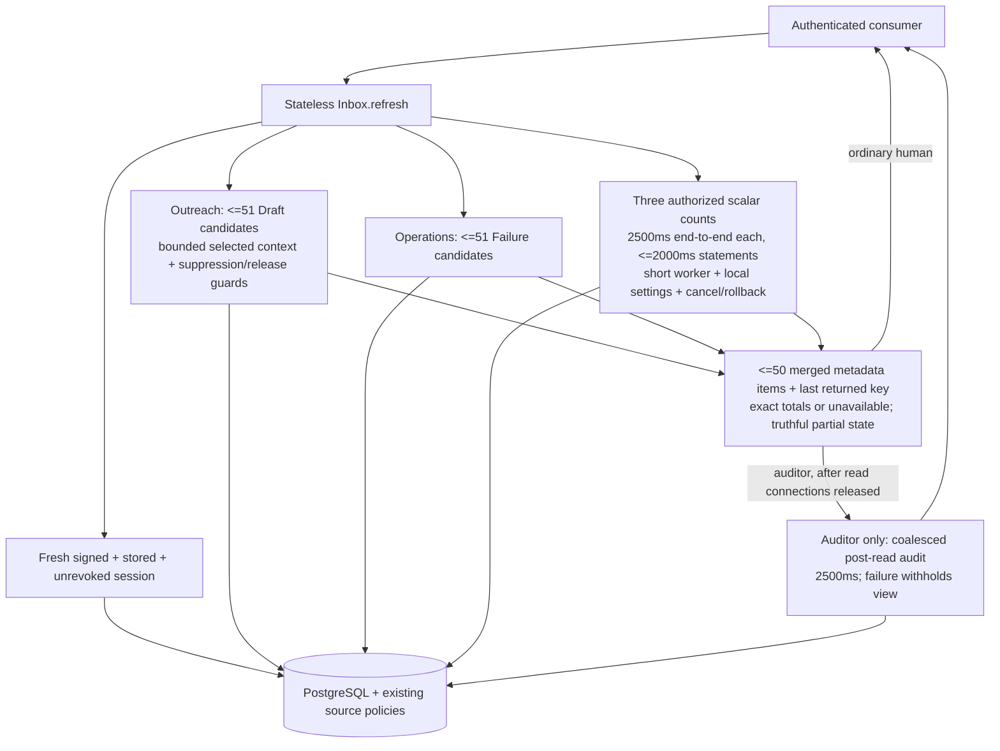

# Home inbox read runtime

Hand-authored: 2026-10-14. Source: [inbox-runtime.mmd](inbox-runtime.mmd).
Implements accepted ADR-0015 and the C1-02 read-only slice. There is no new
Ash domain/resource, persistent task, supervisor child or screen. C1-03
commands and H1 UI are excluded; no calls or spend occur on refresh.

Capabilities are advisory. Edit/retry are blocked pending reviewed atomic
C1-03 adapters. Reviewer Home conservatively withholds gen-2 Claude drafts
because the existing release metadata policy excludes that role (#152);
its pending-Draft total is unavailable, not a reduced ready count. Source
draft-page policy is unchanged. Bodies, parsed outputs, stderr and Payloads
are never read for this projection. Exact aggregates can scan many index
entries; they are time/result bounded, not fixed-scan-work bounded.
