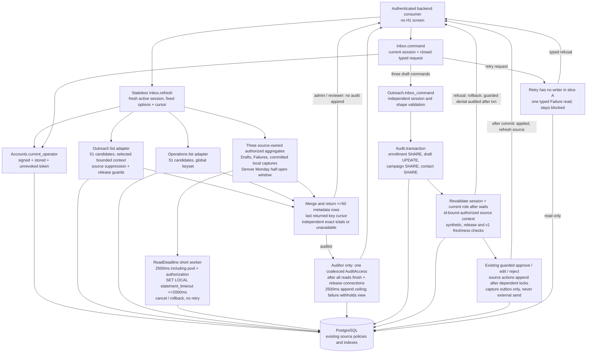

# Home inbox read and command runtime

Hand-maintained: 2026-10-17. Source: [inbox-runtime.mmd](inbox-runtime.mmd).
Implements accepted ADR-0015: C1-02 reads and C1-03 slice A's three fixed
draft commands. There is no new Ash domain/resource, persistent task,
supervisor child or screen. The retry writer and H1 UI remain excluded;
refresh and these commands never invoke a model or send external email.

Cursor signing and freshness use one validated configuration secret per
authenticated request; the facade does not call or require the web Endpoint
process. Missing/invalid signing configuration fails closed. The Draft
aggregate is the single exact, field-authorized metadata-only call site in
the reviewed R0 aggregate inventory; output-field aggregates stay forbidden.

Capabilities are advisory. Edit uses the atomic C1-03 adapter; retry remains
blocked pending slice B's reviewed recovery adapter. The source adapter
protects comparison and mutation together, and revalidates the real stored
session after lock waits; it never takes a generic audit-head lock. The
pure Command validator and Binding codec own no policies or processes.
Known source repeats return stale, not an unproven successful replay.
Source errors and lost replies never claim rollback or trigger auto-retry.

Reviewer Home conservatively withholds gen-2 Claude drafts
because the existing release metadata policy excludes that role (#152);
its pending-Draft total is unavailable, not a reduced ready count. Source
draft-page policy is unchanged. Bodies, parsed outputs, stderr and Payloads
are never read for this projection. Exact aggregates can scan many index
entries; they are time/result bounded, not fixed-scan-work bounded.

Forward obligation #153: C5-04 must make the synthetic-only list and count
guards consume its real-data switch together, preserving SQL/Elixir parity.
Until then, one withheld/corrupt Draft context withholds the whole Draft
producer, not only that row. Lists have bounded candidates but use existing
queue/query timeout defaults; sequential reads have no whole-page deadline.
