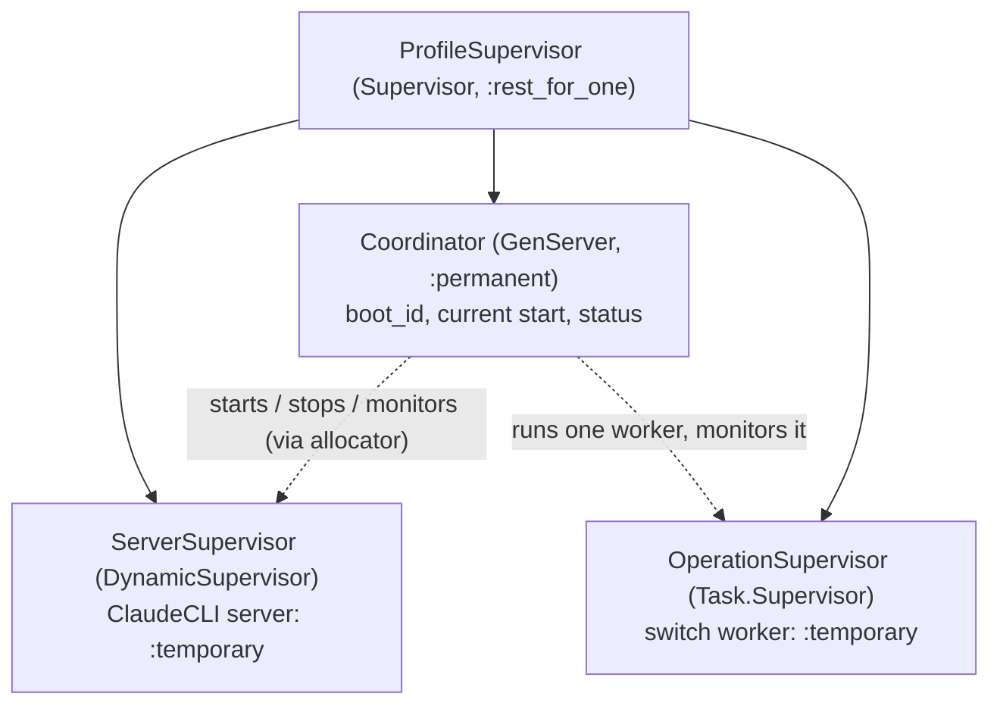

# C2-02b2 (#52, slice b2α): activation, rollback and ownership (draft 3)

**Status:** draft 3, 2026-10-15, for Codex's recheck. No code.
- **Draft 2** (`3246a2c`) was NEEDS-REVIEW (Codex, 6986be38). It accepted
  the b2β deferral and conditional adoption. Four b2α residuals are fixed
  here:
  - **R1:** a trusted stage capability (section 1a);
  - **R2:** the allocator/finalizer lock order with the switch FK (section
    1b);
  - **R3:** a runtime launch hold for uncertain outcomes, and safe adoption
    (section 2a);
  - **R4:** a correlated, acknowledged Reaper receipt (section 3, "The
    Reaper cleanup receipt").
- **Draft 1** (`40973a6`) was NEEDS-REVIEW (Codex, 5e037350). Its four
  findings and how this draft answers them:
  - **MF1, the generation was reused.** It is now a durable start
    allocator, bound to the owner.
  - **MF2, supervision and crash ownership.** There is now a supervision
    tree, the per-stage crash outcomes, and a minimum fail-closed restart
    in b2.
  - **MF3, a caller proof and pgrep.** The resolver is now **staged** to
    b2β (Codex's optional staging). Until it lands, a blocked switch keeps
    no exit, fail-closed, as in slice a.
  - **MF4, the resolver delta.** Deferred with the resolver to b2β. No
    blocked → completed or failed path exists in b2α.
- **Accepted from draft 1:**
  - the b1 handoff (a drained ledger is necessary, never sufficient;
    nullable counts are unknown);
  - the cleanup veto before a stop;
  - no rollback over a held or unconfirmed lease;
  - never `Reaper.release/1`;
  - a no-call preflight that leaves the attestation `:pending`;
  - the actor split (admin request, `agent_runtime` drain, `model_runtime`
    finalization);
  - OQ-2: a 10 s maximum per named cleanup wait.

**Staging (Codex optional; tripwire 1, growth: the owner is told).**
- **b2α (this document):** generation and ownership, supervision,
  activation and rollback, `block`, crash finalization.
- **b2β (next):** the attended resolver, with a trusted operation-bound
  receipt or an explicit owner attestation, never a scan.
- **Order:** both land before R0-05. Nothing in production can request a
  switch before R0-05, so a blocked switch with no exit can't occur in use
  before b2β.

**Safe exit of b2α:**
- **No switch requested:** the new supervision tree runs the one server at
  the setting's desired profile (the default before any setting), started
  through the allocator. It behaves like `Runtime.children/0` today, and
  the existing ClaudeCLI and admission suites pass unchanged.
- **A pending switch at a coordinator start** is blocked, fail-closed.

## 1. Generation: a durable start allocator (MF1)

**New resource `ModelServerStart`.** One row per server start attempt, in
the Agents domain; it is the authority on generations.
- **Attributes:**
  - `tenant_id`;
  - `generation : integer ≥ 1`, unique per tenant;
  - `boot_id : uuid`, minted by each coordinator start;
  - `profile_id`, a real profile;
  - `reason`: `:boot | :replacement | :activation | :rollback`;
  - `switch_id`: nullable, required for `:activation` and `:rollback`;
  - `inserted_at`.
- **Allocation:** the `:allocate` action (`model_runtime` of the tenant,
  only inside the coordinator's own phase).
  - In one short transaction it locks the tenant's **latest start row**
    `FOR UPDATE` (or, with none, uses the unique index), then inserts
    `generation = latest + 1`, and appends `model.server.start_allocated`.
  - A concurrent allocation meets the unique `(tenant_id, generation)`
    index and retries once. Gaps are harmless; reuse is impossible.
- **Every start is allocated first:** boot, replacement after an
  unexpected server death, activation, and rollback. No supervisor
  restarts a server on its own (section 2), so no start bypasses the
  allocator.

**The two identities stay separate:**
- `S.server_generation` is the generation of the start that was
  **running when S was requested**. The coordinator supplies its current
  start's generation;
- the **candidate** (activation) and **rollback** starts get their own,
  later generations.

**Ownership of finalization** (narrow delta to slice a's `complete`,
`fail` and `block`).
- **A new required argument** `owner: %{boot_id, start_id}`. Its guard,
  inside the existing `:transition`/`:apply` phase after the existing
  locks:
  - the stored start row exists, is of the tenant, and has
    `boot_id == owner.boot_id`;
  - it is the tenant's **latest start**, so a replacement coordinator,
    whose boot allocates a newer start, makes every older owner stale;
  - **for `complete`:** `reason == :activation`, `switch_id == S.id`,
    `profile_id == S.to_profile_id`;
  - **for `fail`:** `reason == :rollback`, `switch_id == S.id`,
    `profile_id == S.from_profile_id`;
  - **for `block`:** any start of this owner's boot.
- **Unchanged:** the stale-generation check (`S.server_generation`) still
  runs first, before any replay. A coordinator that holds the numerically
  correct S generation but a stale `boot_id` or a non-latest start is
  refused.
- **No runtime RPC under the ledger lock.** The guard reads stored rows
  only. The coordinator compares its own in-memory pid and profile with
  those rows before it calls.
- **Lock order:** setting → switch → latest start (`FOR SHARE`) → head.

### 1a. Stage capability and start lifecycle (R1)

**An allocated start is intent only.** `ModelServerStart` gains a
forward-only `status`:
- `:allocated → :started` (the server process is up, with its pid, node
  and the reaper pid recorded);
- `:started → :ready` (the no-call preflight passed);
- `:allocated | :started → :failed`.

Each transition is a `model_runtime` action that requires the
coordinator's capability (below), and appends
`model.server.start_<status>`. There is no other write.

**The capability.**
- **What it is:** the coordinator mints a fresh `make_ref()` per operation
  stage. It registers it in its own state, bound to
  `{tenant, S, S.server_generation, boot_id, start_id, pid, profile,
  stage}`. Only the switch worker receives it. It is never stored and
  never readable.
- **How a call proves it:** every b2 ledger call (start transitions,
  `complete`, `fail`, `block`) passes `stage: capability`. **Before**
  opening its transaction, the domain function asks the coordinator
  `Coordinator.verify(capability)`. The answer is the bound snapshot for
  a currently registered capability, else `:stale`. This RPC happens
  outside every ledger lock.
- **What the guarded transaction checks,** on stored rows, against that
  snapshot:
  - the start row is the tenant's current latest (section 1b);
  - its `boot_id` and `start_id` match the snapshot;
  - its `status` meets the action's prerequisite.
- **The prerequisites:**
  - **`complete`:** the latest start is `:ready`, `:activation`, for S,
    with `to`;
  - **`fail`:** the latest start is `:ready`, `:rollback`, for S, with
    `from`;
  - **`block`:** any latest start of the snapshot's boot, any status, or
    none started at all. Block stays possible when a start failed or no
    server exists.
- **What a direct call can't do:** copied ids, an allocated-but-unstarted
  or failed row, a stale worker's expired capability, or a forged context
  all fail. With no live registered capability there is no snapshot; with
  no `:ready` row the prerequisite fails.
- **Consumption:** the coordinator retires a capability when its stage
  ends, or when its owner, start or pid changes.

### 1b. The lock order, with the switch FK (R2)

**One per-tenant serialization point,** `ModelServerCounter`: one row per
tenant, `last_generation`, upserted lazily on the unique tenant identity.
- **Allocation,** in one transaction:
  1. upsert-and-lock the counter `FOR UPDATE`;
  2. **in a new statement after the lock,** read the latest start
     (`generation == counter.last_generation`). Read Committed sees every
     allocation committed by an earlier lock holder;
  3. insert the start at `last_generation + 1` (its FK takes `KEY SHARE`
     on S);
  4. bump the counter;
  5. append the event.

  The unique `(tenant_id, generation)` index is a backstop only. A
  violation is a typed `{:error, :allocation_conflict}`, with the whole
  transaction rolled back and no retry inside it. The coordinator may
  retry the allocation call, bounded by its stage deadline.
- **Finalization** (`complete`, `fail`, `block`) and the start transitions
  take: setting `FOR UPDATE` → **counter `FOR SHARE`** → switch
  `FOR UPDATE` → the latest start (read fresh after the counter lock) →
  head.
- **Why no inversion:** the allocator holds the counter `FOR UPDATE`
  before the switch's `KEY SHARE`, and every finalizer takes the counter
  before the switch, so neither can hold the switch while waiting for the
  counter.
- **Unchanged:** request and drain don't touch the counter, so their
  setting → switch → head order is unchanged.
- **A finalizer that waited** on the counter re-reads the latest start
  after the lock, so an owner whose start is no longer latest is refused.

## 2. Supervision and ownership (MF2)

**The tree:**
- **`ProfileSupervisor`** replaces today's bare server child in
  `Runtime.children/0`. It runs `:rest_for_one` in this order:
  - **`ServerSupervisor`** (first): a `DynamicSupervisor` whose ClaudeCLI
    child is `:temporary`. It **never restarts** a server itself.
  - **`Coordinator`** (second): the only process that starts, stops or
    replaces a server, always through the allocator. It stays responsive:
    switch work runs in a worker, and `status/0` answers from its own
    state.
  - **`OperationSupervisor`** (third): at most one `:temporary` switch
    worker, started and monitored by the coordinator.
- **A dead coordinator** restarts `OperationSupervisor` too
  (`:rest_for_one`), so no worker outlives the owner that granted it
  authority. The running server survives, and is re-owned under the new
  boot (below).
- **A worker's authority** is the coordinator's `owner` (`boot_id`, the
  current `start_id`) plus an operation token. The coordinator rejects any
  reply whose token is stale.

**The coordinator's start (VM boot or restart: the minimum fail-closed
rule in b2):**
1. Mint a new `boot_id`.
2. **If the tenant has a pending switch,** its operation's owner is gone.
   - Allocate a start (`:replacement`, at the current server's profile,
     or the setting's desired profile if no server is running), then
     `block` S with reason `:coordinator_restarted`, as that owner.
   - Cleanup can't be known after a crash, so it is blocked and never
     failed. Slice c may refine this to failed, when it can prove clean
     work.
3. **If a switch is blocked** (now, or from before), the fence keeps real
   calls closed. A server keeps running only if one already is: none is
   started, and none is restarted over an unconfirmed lease.
4. **Otherwise,** a server running under the old boot is **adopted**:
   - a new `:replacement` start is allocated, and the coordinator then
     confirms the running pid's published profile matches it. On a
     mismatch, it stops that server and starts the start's profile;
   - with no server running, it allocates `:boot` and starts the
     setting's desired profile.

**An unexpected server death** (no switch open): the coordinator sees
`DOWN`, allocates `:replacement`, and starts the same profile. The new
server's admission stays closed until the dead server's reaper confirms
cleanup (today's lease rule). That is what a supervisor restart does
today, but now through the allocator.

**Ingress.**
- **During a switch,** the fence (b1, durable, under the head) is the
  authority.
- **After reopening,** a caller that prepared against the old profile is
  refused by `:profile_mismatch_at_launch` and by the b1 epoch rule.
- **`admission/1` being `:open`** is a cleanup and lease status only,
  never an ownership check.

### 2a. The runtime launch hold, for uncertain outcomes (R3)

The DB fence can open while a finalization's outcome is still unknown (a
`complete` that committed but whose reply was lost). So b2 adds a
**server-side launch hold**, separate from cleanup admission:
- **Setting it:** a server started by the coordinator during a switch
  (candidate or rollback), or adopted after a coordinator restart, starts
  **held**: the start option `hold: hold_ref`.
- **What it refuses:** while held, the server refuses every dequeued
  call before `admit_launch` (`{:error, :provider_held}`), and
  `Runtime.resolve/1` refuses it early. No port opens.
- **Releasing it:** only `ClaudeCLI.release_hold(server, hold_ref)` with
  the exact ref releases it.
- **When the coordinator releases it:** only after a **reconciled** stored
  outcome by the current owner: one fresh read of S and the latest start,
  outside locks.

| Reconciled read | Hold |
|---|---|
| S `:completed`, the latest start is this owner's `:ready` activation | released on the candidate |
| S `:failed`, the latest start is this owner's `:ready` rollback | released on the rollback server |
| S `:pending` (the finalization didn't commit) | kept; the coordinator then calls `block` (with the capability) and reconciles again |
| S `:blocked` | kept (b2β owns the exit) |
| unreadable, or a different owner or start is latest | kept; retried on the coordinator's tick; never released by a stale operation |

The same reconciliation applies to errors from `fail` and `block`, not
only `complete`. A replacement owner never releases a hold it didn't
issue: a restarted coordinator issues a new hold to the server it adopts
(below).

**Adoption (OQ-4, accepted with conditions)** at a coordinator restart.
The coordinator adopts the surviving server only if all of these hold:
- it is the exact `ServerSupervisor` child;
- its published profile is the setting's desired one;
- its reaper is published and holds the lease;
- no switch is pending.

**On adoption,** the coordinator:
- allocates a `:replacement` start (`:allocated → :started → :ready` on
  the observed facts);
- sets a new hold, then releases it after the reconciled read. Known
  in-flight work and its frozen per-call profile continue; the hold
  refuses only new dequeues.
- Adoption is a new ownership claim, never a fresh spawn or preflight
  proof.

**Otherwise:**
- **a pending switch:** block it (`:coordinator_restarted`), and keep any
  server held;
- **a profile mismatch with no open switch:** the bound stop protocol
  (receipt, section 3), then a fresh start;
- **an unknown observation:** stay held.

Nothing is stopped or started blindly.

## 3. The switch (the worker), with crash outcomes

The worker carries `owner` and `token`. Every step is outside the setting
and head transactions. Before every stop, start and finalize, it re-reads
the coordinator's binding, `{boot_id, start_id, pid, profile}`, and stops
if it is stale.

| Stage | Action | Crash / failure here → outcome |
|---|---|---|
| 1 Request | the admin request, `server_generation` = the current start's generation | worker died after commit → the coordinator sees `DOWN` → `block` (`:operation_died`), as its owner |
| 2 Drain | b1 `drain_profile_switch`, CLI timeout + 30 s | a timeout, a nil count, observation failed or settlement failed → `block` with that reason; `:switch_not_open` or `:stale_server_generation` → stop, nothing touched |
| 3 Veto | the bound old pid is the named server at the current start; `admission(pid) == :open`; its lease holder is **that server's own reaper** (new published `ClaudeCLI.reaper/1`) | any other or unreadable answer → `block` |
| 4 Stop old | the coordinator stops the bound pid, and **only** if it is still the bound pid | a lease release without the bound reaper's **cleanup receipt** (below) within 10 s, a dead holder or a lost observation → `block` (`:old_cleanup_unconfirmed`); no restart, no release |
| 5 Start candidate | allocate `:activation` (S, `to`), then start | a failed start → stage 7 |
| 6 Preflight | the pin check; `profile(pid) == to`; `admission == :open`; attestation `:pending` with the shim found; no model call | pass → stage 8; fail → stage 7 |
| 7 Rollback | stop the candidate (as stage 4), allocate `:rollback` (S, `from`), start it, then the same preflight | pass → `fail(S, owner: rollback start)`; the candidate's cleanup unconfirmed or the old preflight failing → `block` |
| 8 Finalize | `complete(S, stage: capability)`; the candidate stays **held** | the result lost or failed → the reconciliation table (2a); the hold is released only on a reconciled current-owner success; never a rollback over a possible commit |

- **A coordinator death at any stage:** the worker dies with it
  (`:rest_for_one`), and the new coordinator's start rule blocks S.
- **A request caller's death:** irrelevant once the request committed.
  The coordinator owns the switch.
- **Model calls:** no stage makes one, and the RED pins zero launches.

### The Reaper cleanup receipt (runtime delta, R4)

- **`ClaudeCLI.reaper(server)`:** publishes the server's own reaper pid
  (never blocks).
- **`Reaper.subscribe(reaper, ref)`:** a **synchronous** call made before
  the stop. `ref` is a fresh private `make_ref()`, bound by the coordinator
  to `{S, boot_id, start_id, server pid, reaper pid}`.
  - The reaper monitors the subscriber and replies `{:subscribed, ref}`.
  - The coordinator stops the server **only after** that acknowledgement,
    so the reaper can't exit before it has registered the subscriber.
- **The receipt.** On the server's death the reaper confirms every tracked
  tree stopped, removes the workspaces, releases **its own** lease, and
  then sends `{:reaper_cleanup_confirmed, ref, %{name, tracked: n}}` before
  it exits.
  - Signals from one process arrive in order, so the receipt precedes its
    `DOWN`.
- **Validation:** only a message carrying the exact registered `ref`
  counts. A forged tuple naming the right pid with a wrong or missing ref
  is ignored, and a stale or duplicate ref (single-use) is ignored.
- **`DOWN` without a prior receipt,** a lease absent without the receipt
  (a manual erase, VM loss), a dead holder, or the 10 s monotonic bound
  passing → **unconfirmed** → `block`.
- **The subscriber's death:** the reaper drops the subscription; a new
  operation subscribes afresh.
- `Reaper.release/1` is unchanged, and b2 never calls it. Process scans
  are diagnostic only.

## 4. ADR evaluation

The coordinator-owned server lifecycle and the durable generation are a
cross-cutting runtime pattern. **Recommended:** a narrow amendment to
**ADR-0004** (runtime model selection: the supervised server is now
coordinator-owned; generations are allocated, never derived).

Proposed, needing the owner's acceptance. It is checked against:
- ADR-0005 (C8, concurrency 1: unchanged);
- ADR-0009 (audit coupling: allocation and finalization are audited
  actions; no raw writes).

No new dependency.

## Entity Model

**Entity Model trigger:** yes:
- a new persisted resource (`ModelServerStart`) and its action and event;
- an action-contract delta on switch `complete`, `fail` and `block`
  (`owner`);
- the runtime ownership and observation contracts (coordinator, ClaudeCLI
  reaper publication, Reaper cleanup receipt).

| Entity | New / Existing | Purpose | Attributes | Relationships | Invariants / Lifecycle | Policy/Actor | Open Questions |
|---|---|---|---|---|---|---|---|
| ModelServerStart | New | One server start attempt; the generation authority. An allocation is **intent** only | `tenant_id`; `generation : int ≥ 1`, unique `(tenant_id, generation)`; `boot_id : uuid`; `profile_id : real profile`; `reason : :boot \| :replacement \| :activation \| :rollback`; `switch_id : uuid, nullable` (required for activation and rollback, check constraint); `status : :allocated \| :started \| :ready \| :failed`; `pid`, `node`, `reaper_pid : string, nullable` (set at `:started`, diagnostic identity); `inserted_at`, `updated_at` | belongs_to Tenant; belongs_to ModelProfileSwitch (optional, same tenant, `on_delete: :restrict`) | **allocate** under the counter lock (1b): generation = last + 1; status forward-only (`allocated → started → ready`, `allocated \| started → failed`); no destroy. **Events (closed metadata):** `model.server.start_allocated` and `start_<status>`, with start id, tenant, generation, boot, profile, reason, optional switch, status | **allocate and transitions:** `model_runtime` with a verified coordinator capability (1a); **read:** admin, auditor (audited), `agent_runtime`, kernel | none |
| ModelServerCounter | New | The per-tenant allocation serialization point | `tenant_id` (unique), `last_generation : int ≥ 0` | belongs_to Tenant | upserted lazily; bumped only by allocate, under `FOR UPDATE`; finalizers take it `FOR SHARE` before the switch (1b) | written only by allocate; read by kernel | none |
| ModelProfileSwitch | Existing (action-contract delta) | One requested change | unchanged | is referenced by ModelServerStart (activation, rollback) | `complete`, `fail` and `block` take the required `stage: capability`, verified with the coordinator before the transaction and checked in it against the stored latest start and its status (1a). The order is setting → counter → switch → start → head (1b), after the stale-generation check and before replay. **Blocked keeps no exit in b2α** | unchanged (`model_runtime`) | none |
| Coordinator, ServerSupervisor, OperationSupervisor (runtime) | New | Own the server lifecycle and the switch worker | `boot_id`, the bound `{start_id, generation, pid, profile}`, the stage, the operation token | ProfileSupervisor `:rest_for_one` | no server is started except through the allocator; no worker outlives its coordinator; a stale token or binding stops a worker | drain as `agent_runtime`; allocation and finalization as `model_runtime`; the request is the admin's | none |
| ClaudeCLI server (runtime) | Existing (observation and hold delta) | The model server | publishes its reaper pid (`reaper/1`); a start option `hold:`, plus `release_hold/2` with the exact ref | — | while held, refuses every dequeued call before `admit_launch` (`:provider_held`), and `Runtime.resolve/1` refuses it early; the hold is separate from cleanup admission | set and released only by the coordinator | none |
| ClaudeCLI.Reaper (runtime) | Existing (receipt delta) | Crash-safe owner of CLI work | `subscribe/2` (synchronous, acknowledged, private ref); the receipt `{:reaper_cleanup_confirmed, ref, %{name, tracked}}` | monitors its subscriber | the receipt is sent only after confirmed cleanup and its own lease release, before exit; single-use refs; never for manual absence; `release/1` unchanged and never called by b2 | n/a | none |

ModelProfileSetting: existing dependency: unchanged — relationship/policy/lifecycle impact checked, none found.

## Tests (RED first)

1. **Allocation and generation:**
   - a no-switch restart allocates a new, higher generation;
   - a clean rollback, then a restart, never reuses a generation;
   - concurrent allocations never collide (independent connections);
   - a direct `:allocate` outside the phase is Forbidden;
   - append-only.
2. **Ownership:**
   - a stale owner with the numerically correct `S.server_generation` is
     refused (a stale `boot_id`, or a non-latest start);
   - a wrong reason, switch or profile for `complete` or `fail` is
     refused;
   - the stale-generation check still precedes replay;
   - existing replays keep working with the right owner.
3. **Supervision and crashes:**
   - deaths of the coordinator, the worker, the candidate server, the old
     server and the Reaper at each stage boundary;
   - a replacement server racing a stale worker;
   - a request caller's death;
   - a lost or failed `complete` (the stored state reconciled; never a
     rollback over a committed completion).

   Each asserts:
   - the fence and admission state;
   - the desired and effective profile;
   - no generation bypass;
   - no port and no model call;
   - no `Reaper.release/1`.
4. **Cleanup receipt:**
   - only the bound reaper's receipt confirms;
   - a manually absent lease, a dead holder, or a `DOWN` without the
     receipt → `block`;
   - the 10 s bound is never reset.
5. **The coordinator's start:**
   - a pending switch → blocked (`:coordinator_restarted`);
   - a blocked switch → no server started over an unconfirmed lease;
   - a running server is adopted under a new `:replacement` start;
   - a profile mismatch is replaced.
6. **The happy path, rollback and blocks**, as in draft 1, with `owner`
   bound throughout and zero model calls.
7. **Safe exit:** with no switch, the existing ClaudeCLI, admission and SDR
   suites pass unchanged under the new tree.

### RED additions for draft 3

- **R1:**
  - an allocated-but-never-started candidate, then a direct `complete` →
    refused;
  - a failed preflight, then a direct `complete` with valid latest ids →
    refused;
  - a stale worker borrowing the newest ids;
  - a wrong or expired capability;
  - the legitimate `complete`, `fail` and `block`, each with its distinct
    prerequisite, and `block` with no server started.
- **R2,** on independent connections, with all workers joined:
  - a held allocator against a finalizer, in both orders, with the switch
    FK exercised;
  - a newer allocation committing while a finalizer waits;
  - three allocation contenders (serialized by the counter, all
    succeeding);
  - the counter's first-row race and rollback.
- **R3:**
  - `complete` commits, the reply is lost and the read is unavailable;
    then an ordinary, a prepared and a direct-pid call each try to send →
    no launch while held;
  - the same after an owner replacement, and after a failed
    finalization;
  - adoption: known in-flight work continues;
  - a wrong or unmanaged pid, a profile mismatch, or unknown or held
    cleanup → nothing reopened blindly.
- **R4:**
  - stopping before the subscription acknowledgement (not possible:
    pinned);
  - the receipt versus `DOWN` ordering;
  - a forged tuple with the right pid and a wrong or missing ref;
  - a stale receipt from a previous operation;
  - a manually absent lease;
  - a dead holder;
  - the subscriber's death.

## Open questions

- **OQ-1, resolved:** a durable allocator (`ModelServerStart`), as Codex
  recommended. Max-switch + 1 is dropped.
- **OQ-2, accepted:** 10 s per named cleanup wait, one monotonic deadline,
  bounded calls, timeout or unknown → `block`.
- **OQ-3, moved to b2β:** a process scan is diagnostic only. The resolver
  needs the bound cleanup receipt, or an explicit owner attestation bound
  to the switch, tenant, prior runtime identity and outcome.
- **OQ-4, new:** adopting a running server at a coordinator restart (step
  4) versus always restarting it.
  - **Recommended:** adopt, with a fresh `:replacement` start and a
    profile check. Restarting would kill in-flight calls on every
    coordinator crash.
