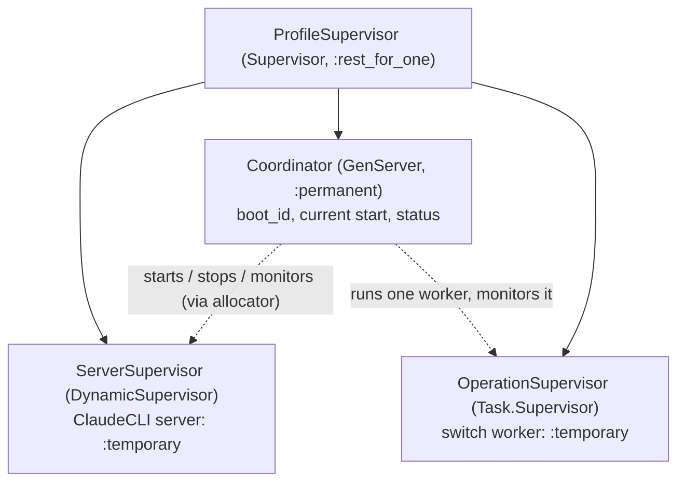

# C2-02b2 (#52, slice b2α): activation, rollback and ownership (draft 4)

**Status:** draft 4, 2026-10-15. **Interface and entity PASS** at exact
`c00ed69e9fcf635e84cb342b8dfca0c252de4eda`.
- **The review:** Codex, the independent ai-pair reviewer (recipe
  `ai_pair=true`, `codex_review=true`).
  - Request `m_1792064382520842000_faeeb578`; reply `f9834161`; 2026-10-15
    11:42 UTC.
  - Report:
    `~/.local/state/sdr-agent/handoff-20261008/tmp/codex-c2-02b2-c00ed69-interface-pass.md`.
- **What it authorizes:** scoped RED only. GREEN, the owner's acceptance
  of the ADR-0004 amendment, runtime activation, real calls, spend and
  merge stay separate gates.
- **Binding implementation obligations** (from that report):
  1. enforce the coordinator identity, actor, tenant and stored-row
     checks on the direct Ash action paths too, with no `model_runtime`
     widening and no production test bypass. Raw refs stay out of status,
     events and snapshots;
  2. the first allocation is the boot claim: it never requires the
     previous latest start to already carry the new boot, nor any row at
     a cold boot. A nominal same-stage replay can't rewrite facts;
  3. b1's full end-to-end deadline mechanics apply to every coordinator
     call and observation, not only a per-statement limit;
  4. "held" is an acknowledged server state, established or retained
     before it is reported, never inferred;
  5. truthful lifecycle, replay and error behavior. A failure before the
     start may have no pid, node or reaper. A same-action retry doesn't
     bump the revision or append twice. The RED fails for its intended
     reason.
- **Draft 3** (`a1b4183`; unchanged at `c5e9fc0`) was NEEDS-REVIEW (Codex,
  0691c11b). R2 (the counter and FK order) and R4 (the acknowledged
  receipt) are accepted. Two residual groups are fixed here:
  - **D3-1, the permit's lifetime across lock waits.** The pre-transaction
    `Coordinator.verify/1` snapshot is **removed**. Every b2 ledger write
    is now executed **by the coordinator process itself**, and is fenced
    inside the transaction by the stored latest start's boot (section 1a).
    The coordinator can't retire or change a stage while one of its own
    calls is in flight, because it is that call's process.
  - **D3-2, the normal boot and adoption path.**
    - Per-action lock sets mean a cold boot needs neither a setting nor
      S (1b).
    - A truthful readiness evidence kind (`:spawn_preflight` or
      `:adopted`).
    - A synchronous re-hold API for an existing pid.
    - A reconciliation branch that releases the hold when no switch is
      open (2a).
  - **Text synchronization:** the old latest-row allocator, the `owner:`
    argument, the old lock order and the append-only wording are removed.
    Section 1b is the only normative lock description.
- **Draft 2** (`3246a2c`) was NEEDS-REVIEW (Codex, 6986be38). It accepted
  the b2β deferral and conditional adoption. Draft 3 answered its four
  b2α residuals:
  - **R1:** a trusted stage capability (section 1a; its pre-transaction
    snapshot is superseded by D3-1);
  - **R2:** the allocator/finalizer lock order with the switch FK (section
    1b);
  - **R3:** a runtime launch hold for uncertain outcomes, and safe adoption
    (section 2a);
  - **R4:** a correlated, acknowledged Reaper receipt (section 3, "The
    Reaper cleanup receipt").
- **Draft 1** (`40973a6`) was NEEDS-REVIEW (Codex, 5e037350). Its four
  findings and how this draft answers them:
  - **MF1, the generation was reused.** It is now a durable start
    allocator, bound to the owner.
  - **MF2, supervision and crash ownership.** There is now a supervision
    tree, the per-stage crash outcomes, and a minimum fail-closed restart
    in b2.
  - **MF3, a caller proof and pgrep.** The resolver is now **staged** to
    b2β (Codex's optional staging). Until it lands, a blocked switch keeps
    no exit, fail-closed, as in slice a.
  - **MF4, the resolver delta.** Deferred with the resolver to b2β. No
    blocked → completed or failed path exists in b2α.
- **Accepted from draft 1:**
  - the b1 handoff (a drained ledger is necessary, never sufficient;
    nullable counts are unknown);
  - the cleanup veto before a stop;
  - no rollback over a held or unconfirmed lease;
  - never `Reaper.release/1`;
  - a no-call preflight that leaves the attestation `:pending`;
  - the actor split (admin request, `agent_runtime` drain, `model_runtime`
    finalization);
  - OQ-2: a 10 s maximum per named cleanup wait.

**Staging (Codex optional; tripwire 1, growth: the owner is told).**
- **b2α (this document):** generation and ownership, supervision,
  activation and rollback, `block`, crash finalization.
- **b2β (next):** the attended resolver, with a trusted operation-bound
  receipt or an explicit owner attestation, never a scan.
- **Order:** both land before R0-05. Nothing in production can request a
  switch before R0-05, so a blocked switch with no exit can't occur in use
  before b2β.

**Safe exit of b2α:**
- **No switch requested:** the new supervision tree runs the one server at
  the setting's desired profile (the default before any setting), started
  through the allocator. It behaves like `Runtime.children/0` today, and
  the existing ClaudeCLI and admission suites pass unchanged.
- **A pending switch at a coordinator start** is blocked, fail-closed.

## 1. Generation: a durable start allocator (MF1)

**New resource `ModelServerStart`.** One row per server start attempt, in
the Agents domain; it is the authority on generations.
- **Attributes:** see the entity table. Identity and provenance are
  immutable: `tenant_id`, `generation`, `boot_id`, `profile_id`,
  `reason`, `switch_id`. Only the forward-only `status` and its observed
  facts change (1a).
- **Allocation:** the `:allocate` action, under the per-tenant counter
  (section 1b, the only normative protocol). Gaps are harmless; reuse is
  impossible.
- **Every start is allocated first:** boot, replacement after an
  unexpected server death, activation, rollback and adoption. No
  supervisor restarts a server on its own (section 2), so no start
  bypasses the allocator.

**The two identities stay separate:**
- `S.server_generation` is the generation of the start that was
  **running when S was requested**. The coordinator supplies its current
  start's generation;
- the **candidate** (activation) and **rollback** starts get their own,
  later generations.

**The stale-generation check** (`S.server_generation`) still runs first in
`complete`, `fail` and `block`, before any replay. The ownership fence (1a)
runs after it.

### 1a. Ledger authority and the start lifecycle (R1, D3-1)

**An allocated start is intent only.** `ModelServerStart.status` is
forward-only:
- `:allocated → :started`: the server process is up, and its pid, node
  and reaper pid are recorded;
- `:started → :ready`: with a required `ready_evidence` (below);
- `:allocated | :started → :failed`.

**Who writes the b2 ledger.** Every b2 write is **executed in the
registered `Coordinator` process** (`model_runtime`). Those writes are
`allocate`, the start transitions, and the switch's `complete`, `fail`
and `block`.
- **The worker never performs b2 lifecycle ledger writes.** It does the
  slow work outside them: the b1 drain (as `agent_runtime`), the cleanup waits and the
  preflight checks. It reports each result to the coordinator in a
  message carrying its operation token.
- **There is no capability RPC.** The domain entry point checks
  `Process.whereis(Coordinator) == self()`, a registry lookup and not a
  GenServer call.
- **The coordinator passes its in-memory binding as arguments:**
  `boot_id`, `start_id`, the expected status, `pid` and `profile`, and
  for finalization S and its `server_generation`.
- **Trust boundary:** the registered-coordinator identity plus the stored
  fence below. This is the same in-VM trust level as slice a's private
  phase registry. Copied ids and forged context in any other process
  fail the identity check; a stale coordinator fails the stored fence.

**The stored fence, checked inside the transaction** after the locks of
section 1b:
- the start named is the tenant's **latest start**, read fresh after the
  counter lock;
- its `boot_id` is the caller's.

A new coordinator's first allocation creates a newer latest start under
the counter's `FOR UPDATE`. So every call by an older boot, including one
that was waiting on a lock, is refused once it gets the lock.

**The per-action prerequisites,** on the locked latest start (and S):

| Action | Latest start must be | And |
|---|---|---|
| `start_started` | `:allocated`, this boot | the passed pid is a live `ServerSupervisor` child (observed by the coordinator before the call) |
| `start_ready` | `:started`, this boot, recorded `pid` = the passed pid | `ready_evidence` as below |
| `start_failed` | `:allocated` or `:started`, this boot | — |
| `complete` | `:ready`, `:activation`, `switch_id == S.id`, `profile == S.to`, this boot | S `:pending` at the bound generation |
| `fail` | `:ready`, `:rollback`, `switch_id == S.id`, `profile == S.from`, this boot | S `:pending` at the bound generation |
| `block` | any status of this boot, including `:allocated` or `:failed` | S `:pending`; block stays possible with a failed start or no server |

The prerequisites of `complete` and `fail` are disjoint, so a conflicting
action can't reuse a stage.

**`ready_evidence`,** truthful and closed:
- **`:spawn_preflight`:** a server this coordinator started, which passed
  the no-call preflight:
  - the pinned binary;
  - `profile(pid) == row.profile`;
  - admission observed;
  - the shim found.

  The attestation is never reset: a candidate's stays `:pending`
  (accepted from draft 1), and a boot or replacement start leaves it
  untouched.
- **`:adopted`:** a surviving server re-owned at a coordinator restart
  (section 2a). It is the exact `ServerSupervisor` child, whose published
  profile and published reaper were observed. It claims no new spawn,
  init or preflight.
- `complete` and `fail` accept only `:spawn_preflight`.

**The permit's lifetime (D3-1).** A ledger call's authority lasts exactly
as long as the call:
- **The coordinator is single-threaded.** It can't change its stage,
  owner or binding, or retire anything, while one of its own calls waits
  on a lock. Worker results and `DOWN` messages are handled only after
  the call returns.
- **The call's bound.** Each call is bounded like b1's drain: `queue:
  false` checkout with a retry, and transaction-local `lock_timeout` and
  `statement_timeout` set to `min(the stage's remaining budget, 2 s)`.
  There is no detached execution.
- **The coordinator dies mid-call:** the connection's transaction is
  rolled back with its owner. A transaction that committed just before
  the death is ordinary stored state, and the next boot reconciles it.
  The new boot's first allocation serializes after either.
- **The worker dies:** it holds no ledger authority. The coordinator
  handles `DOWN` after any in-flight call returns, and then calls `block`
  (`:operation_died`).
- **The deadline or a cancellation:** checked by the coordinator between
  calls. Inside a call, the transaction-local timeouts end it with a
  rollback, unless it committed first.
- **An uncertain result** (a client timeout, or a lost connection after
  sending COMMIT): the coordinator issues **no other action** before the
  reconciled read (2a).
  - If S is still `:pending` and the latest start unchanged, it may
    retry the **same** action (slice a's replays are idempotent), or
    call `block`.
  - Anything else follows the reconciliation table.
  - A held server stays held throughout.

### 1b. The lock order, with the switch FK (R2)

**One per-tenant serialization point,** `ModelServerCounter`: one row per
tenant, `last_generation`, upserted lazily on the unique tenant identity.
- **Allocation,** in one transaction:
  1. upsert-and-lock the counter `FOR UPDATE`;
  2. **in a new statement after the lock,** read the latest start
     (`generation == counter.last_generation`). Read Committed sees every
     allocation committed by an earlier lock holder;
  3. insert the start at `last_generation + 1` (its FK takes `KEY SHARE`
     on S);
  4. bump the counter;
  5. append the event.

  The unique `(tenant_id, generation)` index is a backstop only. A
  violation is a typed `{:error, :allocation_conflict}`, with the whole
  transaction rolled back and no retry inside it. The coordinator may
  retry the allocation call, bounded by its stage deadline.
- **The lock sets.** Every action takes a subset of one global order,
  setting → counter → switch → start → head, always in that order:
  - **`allocate`:** counter `FOR UPDATE` (upserted) → the insert's FK
    `KEY SHARE` on S (activation and rollback only) → head. It takes no
    setting.
  - **Start transitions:** counter `FOR SHARE` → the latest start `FOR
    UPDATE` (read fresh after the counter) → head. They take no setting
    and no switch: an update that leaves the FK column unchanged takes no
    `KEY SHARE`. This is why a cold boot needs neither a setting nor S.
  - **`complete`, `fail` and `block`:** setting `FOR UPDATE` → counter
    `FOR SHARE` → switch `FOR UPDATE` → the latest start `FOR UPDATE`
    (read fresh after the counter) → head. S exists only after a request,
    which initializes the setting (slice a), so these paths always have
    both.
- **Why no inversion:** the allocator holds the counter `FOR UPDATE`
  before the switch's `KEY SHARE`, and every finalizer takes the counter
  before the switch, so neither can hold the switch while waiting for the
  counter. The finalizers' and transitions' counter `FOR SHARE` conflicts
  with the allocator's `FOR UPDATE`, which serializes a new boot's first
  allocation against any in-flight call (1a).
- **Unchanged:** request and drain don't touch the counter, so their
  setting → switch → head order is unchanged.
- **A finalizer that waited** on the counter re-reads the latest start
  after the lock, so an owner whose start is no longer latest is refused.

## 2. Supervision and ownership (MF2)

**The tree:**
- **`ProfileSupervisor`** replaces today's bare server child in
  `Runtime.children/0`. It runs `:rest_for_one` in this order:
  - **`ServerSupervisor`** (first): a `DynamicSupervisor` whose ClaudeCLI
    child is `:temporary`. It **never restarts** a server itself.
  - **`Coordinator`** (second): the only process that starts, stops or
    replaces a server, always through the allocator. It stays responsive:
    switch work runs in a worker, and `status/0` answers from its own
    state.
  - **`OperationSupervisor`** (third): at most one `:temporary` switch
    worker, started and monitored by the coordinator.
- **A dead coordinator** restarts `OperationSupervisor` too
  (`:rest_for_one`), so no worker outlives the owner that granted it
  authority. The running server survives, and is re-owned under the new
  boot (below).
- **A worker has no ledger authority** (1a). Its messages carry the
  operation token, and the coordinator ignores a stale one.
- **`status/0`** reads a protected ETS table that only the coordinator
  writes, so it never waits behind a bounded ledger call.

**The coordinator's start (VM boot or restart: the minimum fail-closed
rule in b2).** Each step is a bounded coordinator call (1a). The desired
profile is the setting's, or the default when no setting exists. It is
read without locks, and the setting is never initialized here (only an
admin request initializes it).
1. **Mint a new `boot_id`.**
2. **Read the switch state** with one fresh read: is there a pending or
   blocked S? An unreadable answer counts as unknown: the server stays
   held, and the coordinator retries on its tick.
3. **Allocate this boot's first start,** under the counter `FOR UPDATE`.
   This fences every older boot (1a). Its reason is:
   - `:replacement` if a `ServerSupervisor` child is running;
   - `:boot` otherwise.
4. **Then by case** (the details and the release are in section 2a):
   - **a pending S:** `block` S (`:coordinator_restarted`). Cleanup can't
     be known after a crash, so it is blocked and never failed; slice c
     may refine that when it can prove clean work. Any server stays held.
   - **a blocked S:** the fence keeps real calls closed. A running server
     is re-held; none is started or restarted over an unconfirmed lease.
   - **no open S, and a running child that meets the adoption
     conditions:** adopt it (`:replacement`, `:adopted` evidence), then
     the release branch.
   - **no open S, and a running child that fails them:** the bound stop
     protocol (receipt, section 3), then a fresh start, held, with
     `:spawn_preflight`.
   - **no open S and no child:** start the desired profile, held. After
     `:spawn_preflight`, the release branch.

**An unexpected server death** (no switch open): the coordinator sees
`DOWN`, allocates `:replacement`, and starts the same profile, held. After
`:spawn_preflight`, it takes the release branch (2a). The new
server's admission stays closed until the dead server's reaper confirms
cleanup (today's lease rule). That is what a supervisor restart does
today, but now through the allocator.

**Ingress.**
- **During a switch,** the fence (b1, durable, under the head) is the
  authority.
- **After reopening,** a caller that prepared against the old profile is
  refused by `:profile_mismatch_at_launch` and by the b1 epoch rule.
- **`admission/1` being `:open`** is a cleanup and lease status only,
  never an ownership check.

### 2a. The runtime launch hold, for uncertain outcomes (R3)

The DB fence can open while a finalization's outcome is still unknown (a
`complete` that committed but whose reply was lost). So b2 adds a
**server-side launch hold**, separate from cleanup admission:
- **Setting it:** every server the coordinator starts starts **held**.
  The start option is `hold: ref`, set before the server dequeues
  anything. A surviving server is re-held synchronously with
  `ClaudeCLI.hold(server, ref)`, which replies `{:held, ref}` and replaces
  any previous ref. The coordinator acts only after that reply.
- **What it refuses:** while held, the server refuses every **newly
  dequeued** call before `admit_launch` (`{:error, :provider_held}`), and
  `Runtime.resolve/1` refuses it early. No port opens.
  - A call already past `admit_launch` keeps running with its frozen
    per-call profile.
  - `:provider_held` is handled like today's closed cleanup admission
    (the same caller classification, pinned by RED).
- **Releasing it:** only `ClaudeCLI.release_hold(server, ref)` with the
  **current** ref. An older ref (from a stale owner, or a hold that was
  replaced) gets `{:error, :stale_hold}` and changes nothing.
- **When the coordinator releases it:** only after a **reconciled** read
  by the current owner: one fresh, lock-free read of S and the latest
  start, plus the coordinator's observation of the held server.

| Reconciled read | Hold |
|---|---|
| S `:completed`; the latest start is this boot's `:ready` (`:spawn_preflight`) activation for S, on the held pid | released on the candidate |
| S `:failed`; the latest start is this boot's `:ready` (`:spawn_preflight`) rollback for S, on the held pid | released on the rollback server |
| **The normal branch:** an authoritative read shows **no pending or blocked switch** (none ever, or only terminal history). The latest start is this boot's `:ready` `:boot` or `:replacement`, with recorded pid = the held pid. Its profile equals the desired one (the setting's, or the default). The server's published reaper is observed | released |
| S `:pending` (the finalization didn't commit) | kept; the coordinator calls `block` and reconciles again |
| S `:blocked` | kept (b2β owns the exit) |
| unreadable, a different boot or start is latest, a pid or profile mismatch, or no reaper observed | kept; retried on the coordinator's tick; never released by a stale operation |

- **Uncertain finalizations:** the same reconciliation applies to
  uncertain or failed `fail` and `block` results, not only `complete`.
- **The normal branch is never taken** while any switch is pending or
  blocked, or when the read is unknown.
- **Holds are per owner:** a replacement owner releases only the hold it
  issued itself. A stale owner's ref can't release the new hold.

**Adoption (OQ-4, accepted with conditions)** at a coordinator restart
with no open switch. The coordinator adopts the surviving server only if
all of these hold:
- it is the exact `ServerSupervisor` child;
- its published profile is the desired one;
- its reaper is published and holds the lease.

**On adoption,** in this order:
1. re-hold the server (`hold/2`, acknowledged);
2. allocate the `:replacement` start;
3. `start_started` with the observed pid, node and reaper;
4. `start_ready` with `:adopted`;
5. take the normal release branch.

Known in-flight work continues throughout: the hold refuses only new
dequeues. After the release, newly admitted calls run.

**Otherwise:**
- **a pending switch:** block it (`:coordinator_restarted`) and keep the
  server held;
- **a profile mismatch, or an unmanaged process, with no open switch:**
  the bound stop protocol (receipt, section 3), then a fresh held start;
- **an unknown observation:** stay held.

Nothing is stopped or started blindly.

## 3. The switch (the worker), with crash outcomes

The worker carries only its operation token. It runs the drain, the
cleanup waits and the preflight checks, and reports each result to the
coordinator. The coordinator:
- performs every stop, start and ledger write (1a);
- re-checks its own binding (`{boot_id, start_id, pid, profile}`) before
  each one;
- ignores a result whose token is stale.

No step runs inside the setting or head transactions.

| Stage | Action | Crash / failure here → outcome |
|---|---|---|
| 1 Request | the admin request, `server_generation` = the current start's generation | worker died after commit → the coordinator sees `DOWN` → `block` (`:operation_died`), as its owner |
| 2 Drain | b1 `drain_profile_switch`, CLI timeout + 30 s | a timeout, a nil count, observation failed or settlement failed → `block` with that reason; `:switch_not_open` or `:stale_server_generation` → stop, nothing touched |
| 3 Veto | the bound old pid is the named server at the current start; `admission(pid) == :open`; its lease holder is **that server's own reaper** (new published `ClaudeCLI.reaper/1`) | any other or unreadable answer → `block` |
| 4 Stop old | the coordinator stops the bound pid, and **only** if it is still the bound pid | a lease release without the bound reaper's **cleanup receipt** (below) within 10 s, a dead holder or a lost observation → `block` (`:old_cleanup_unconfirmed`); no restart, no release |
| 5 Start candidate | allocate `:activation` (S, `to`), start it held, then `start_started` | a failed start → stage 7 |
| 6 Preflight | the pin check; `profile(pid) == to`; `admission == :open`; attestation `:pending` with the shim found; no model call | pass → `start_ready` (`:spawn_preflight`), then stage 8; fail → `start_failed`, then stage 7 |
| 7 Rollback | stop the candidate (as stage 4), allocate `:rollback` (S, `from`), start it, then the same preflight | pass → the coordinator's `fail(S)` on the ready rollback start; the candidate's cleanup unconfirmed or the old preflight failing → `block` |
| 8 Finalize | the coordinator's `complete(S)` on the ready activation start; the candidate stays **held** | the result lost or failed → the reconciliation table (2a); the hold is released only on a reconciled current-owner success; never a rollback over a possible commit |

- **A coordinator death at any stage:** the worker dies with it
  (`:rest_for_one`). Any in-flight ledger call rolls back with it, or has
  already committed. The new coordinator's start rule fences the old boot
  and blocks S.
- **A request caller's death:** irrelevant once the request committed.
  The coordinator owns the switch.
- **Model calls:** no stage makes one, and the RED pins zero launches.

### The Reaper cleanup receipt (runtime delta, R4)

- **`ClaudeCLI.reaper(server)`:** publishes the server's own reaper pid
  (never blocks).
- **`Reaper.subscribe(reaper, ref)`:** a **synchronous** call made before
  the stop. `ref` is a fresh private `make_ref()`, bound by the coordinator
  to `{S, boot_id, start_id, server pid, reaper pid}`.
  - The reaper monitors the subscriber and replies `{:subscribed, ref}`.
  - The coordinator stops the server **only after** that acknowledgement,
    so the reaper can't exit before it has registered the subscriber.
- **The receipt.** On the server's death the reaper confirms every tracked
  tree stopped, removes the workspaces, releases **its own** lease, and
  then sends `{:reaper_cleanup_confirmed, ref, %{name, tracked: n}}` before
  it exits.
  - Signals from one process arrive in order, so the receipt precedes its
    `DOWN`.
- **Validation:** only a message carrying the exact registered `ref`
  counts. A forged tuple naming the right pid with a wrong or missing ref
  is ignored, and a stale or duplicate ref (single-use) is ignored.
- **`DOWN` without a prior receipt,** a lease absent without the receipt
  (a manual erase, VM loss), a dead holder, or the 10 s monotonic bound
  passing → **unconfirmed** → `block`.
- **The subscriber's death:** the reaper drops the subscription; a new
  operation subscribes afresh.
- `Reaper.release/1` is unchanged, and b2 never calls it. Process scans
  are diagnostic only.

## 4. ADR evaluation

The coordinator-owned server lifecycle and the durable generation are a
cross-cutting runtime pattern. **Recommended:** a narrow amendment to
**ADR-0004** (runtime model selection: the supervised server is now
coordinator-owned; generations are allocated, never derived).

Proposed, needing the owner's acceptance. It is checked against:
- ADR-0005 (C8, concurrency 1: unchanged);
- ADR-0009 (audit coupling: allocation and finalization are audited
  actions; no raw writes).

No new dependency.

## Entity Model

**Entity Model trigger:** yes:
- a new persisted resource (`ModelServerStart`) and its action and event;
- a new persisted resource (`ModelServerCounter`);
- an action-contract delta on switch `complete`, `fail` and `block`
  (coordinator-executed and boot-fenced);
- the runtime ownership and observation contracts (coordinator, ClaudeCLI
  reaper publication, Reaper cleanup receipt).

| Entity | New / Existing | Purpose | Attributes | Relationships | Invariants / Lifecycle | Policy/Actor | Open Questions |
|---|---|---|---|---|---|---|---|
| ModelServerStart | New | One server start attempt; the generation authority. An allocation is **intent** only | `tenant_id`; `generation : int ≥ 1`, unique `(tenant_id, generation)`; `boot_id : uuid`; `profile_id : real profile`; `reason : :boot \| :replacement \| :activation \| :rollback`; `switch_id : uuid, nullable` (required for activation and rollback, null otherwise: check constraint); `status : :allocated \| :started \| :ready \| :failed`, default `:allocated`; `pid`, `node`, `reaper_pid : string, nullable` (required from `:started` on: check constraint; diagnostic identity); `ready_evidence : :spawn_preflight \| :adopted, nullable` (required iff `:ready`; `:adopted` only with `:replacement`: check constraints); `inserted_at`, `updated_at` | belongs_to Tenant; belongs_to ModelProfileSwitch (optional, same tenant, `on_delete: :restrict`) | **allocate** under the counter lock (1b): generation = last + 1. Identity and provenance are immutable. Status is forward-only (`allocated → started → ready`, `allocated \| started → failed`), with the prerequisites in 1a. No destroy. **Events (closed metadata):** `model.server.start_allocated`, `start_started`, `start_ready` (with `ready_evidence`) and `start_failed`. They carry the start id, tenant, generation, boot, profile, reason, the optional switch and the status; pids are not in events | **allocate and transitions:** `model_runtime`, executed only by the registered coordinator and boot-fenced in the transaction (1a); **read:** admin, auditor (audited), `agent_runtime`, kernel | none |
| ModelServerCounter | New | The per-tenant allocation serialization point | `tenant_id` (unique), `last_generation : int ≥ 0` | belongs_to Tenant | upserted lazily; bumped only by `allocate`, under `FOR UPDATE`; transitions and finalizers take it `FOR SHARE` first (1b) | written only by `allocate`; read by kernel | none |
| ModelProfileSwitch | Existing (action-contract delta) | One requested change | unchanged | is referenced by ModelServerStart (activation, rollback) | `complete`, `fail` and `block` are executed only by the registered coordinator, after the stale-generation check and before replay. They are fenced on the locked latest start (boot, status, reason, switch, profile, evidence; 1a), with the lock set setting → counter → switch → start → head (1b). **Blocked keeps no exit in b2α** | unchanged (`model_runtime`) | none |
| Coordinator, ServerSupervisor, OperationSupervisor (runtime) | New | Own the server lifecycle and the switch worker | `boot_id`; the bound `{start_id, generation, pid, profile}`; the stage; the operation token; the current hold ref; status in a protected ETS table | ProfileSupervisor `:rest_for_one` | no server is started except through the allocator, and every one is started held; every b2 ledger write is in the coordinator's process and bounded; no worker outlives its coordinator; a stale token is ignored | drain as `agent_runtime` (the worker); allocation, transitions and finalization as `model_runtime` (the coordinator); the request is the admin's | none |
| ClaudeCLI server (runtime) | Existing (observation and hold delta) | The model server | `reaper/1` publishes its reaper pid; the start option `hold: ref`; `hold/2` (synchronous, acknowledged, replaces the current ref); `release_hold/2` (the current ref only, else `:stale_hold`) | — | while held, refuses every newly dequeued call before `admit_launch` (`:provider_held`), and `Runtime.resolve/1` refuses it early; calls past `admit_launch` continue; the hold is separate from cleanup admission | set and released only by the coordinator | none |
| ClaudeCLI.Reaper (runtime) | Existing (receipt delta) | Crash-safe owner of CLI work | `subscribe/2` (synchronous, acknowledged, private ref); the receipt `{:reaper_cleanup_confirmed, ref, %{name, tracked}}` | monitors its subscriber | the receipt is sent only after confirmed cleanup and its own lease release, before exit; single-use refs; never for manual absence; `release/1` unchanged and never called by b2 | n/a | none |

ModelProfileSetting: existing dependency: unchanged — relationship/policy/lifecycle impact checked, none found.

## Tests (RED first)

1. **Allocation and generation:**
   - a no-switch restart allocates a new, higher generation;
   - a clean rollback, then a restart, never reuses a generation;
   - concurrent allocations never collide (independent connections);
   - a direct `:allocate` from a process other than the registered
     coordinator is Forbidden;
   - the identity and provenance columns are immutable; only the allowed
     status transitions succeed, and the others are refused.
2. **Ownership:**
   - a stale boot with the numerically correct `S.server_generation` is
     refused (a stale `boot_id`, or a non-latest start);
   - a wrong reason, switch or profile for `complete` or `fail` is
     refused;
   - the stale-generation check still precedes replay;
   - existing replays keep working with the right owner.
3. **Supervision and crashes:**
   - deaths of the coordinator, the worker, the candidate server, the old
     server and the Reaper at each stage boundary;
   - a replacement server racing a stale worker;
   - a request caller's death;
   - a lost or failed `complete` (the stored state reconciled; never a
     rollback over a committed completion).

   Each asserts:
   - the fence and admission state;
   - the desired and effective profile;
   - no generation bypass;
   - no port and no model call;
   - no `Reaper.release/1`.
4. **Cleanup receipt:**
   - only the bound reaper's receipt confirms;
   - a manually absent lease, a dead holder, or a `DOWN` without the
     receipt → `block`;
   - the 10 s bound is never reset.
5. **The coordinator's start:**
   - a pending switch → blocked (`:coordinator_restarted`);
   - a blocked switch → no server started over an unconfirmed lease;
   - a running server is adopted under a new `:replacement` start;
   - a profile mismatch goes through the bound stop protocol, then a held
     fresh start.
6. **The happy path, rollback and blocks**, as in draft 1, coordinator-
   executed throughout, with zero model calls.
7. **Safe exit:** with no switch, the existing ClaudeCLI, admission and SDR
   suites pass unchanged under the new tree.

### RED additions for drafts 3 and 4

- **R1:**
  - an allocated-but-never-started candidate, then `complete` → refused;
  - a failed preflight, then `complete` with valid latest ids → refused;
  - every b2 write called from a process other than the registered
    coordinator (a test process, a stale worker borrowing the newest ids)
    → Forbidden;
  - a `:ready` `:adopted` start offered to `complete` or `fail` →
    refused;
  - the legitimate `complete`, `fail` and `block`, each with its distinct
    prerequisite, and `block` with no server started.
- **D3-1, the permit's lifetime,** on independent connections:
  - a coordinator `complete` is blocked on a real setting or counter
    lock;
  - meanwhile, the operation's worker dies, its stage deadline passes,
    and a cancellation message arrives. None of them is handled before
    the call returns: the call commits or refuses on the stored fence,
    and only then does the coordinator act (`block`, or the
    reconciliation).
  - **A new boot's first allocation** while the old boot's `complete`
    waits: the old call refuses on the boot fence and never commits from
    retired authority.
  - **Killing the coordinator mid-call:** the transaction rolls back, and
    the new boot reconciles.
  - **An uncertain result** (the client times out after COMMIT is sent):
    no other action before the reconciled read. A same-action retry is
    idempotent, and conflicting-action reuse (`fail` on an activation
    start) is refused.
- **R2,** on independent connections, with all workers joined:
  - a held allocator against a finalizer, in both orders, with the switch
    FK exercised;
  - a newer allocation committing while a finalizer waits;
  - three allocation contenders (serialized by the counter, all
    succeeding);
  - the counter's first-row race and rollback.
- **R3:**
  - `complete` commits, the reply is lost and the read is unavailable;
    then an ordinary, a prepared and a direct-pid call each try to send →
    no launch while held;
  - the same after an owner replacement, and after a failed
    finalization;
  - adoption: known in-flight work continues;
  - a wrong or unmanaged pid, a profile mismatch, or unknown or held
    cleanup → nothing reopened blindly.
- **D3-2, boot and adoption,** with no real CLI and no model call:
  - **a cold boot** with neither a setting nor S: `:boot`, `:started`,
    `:ready` (`:spawn_preflight`), the normal release, and a newly
    admitted call runs. No setting is created;
  - **a coordinator restart without any switch history:** adoption with
    `:adopted`; a healthy same-profile active call survives; a newly
    admitted call runs after the release (it isn't held forever);
  - **a restart after a completed switch, and after a rolled-back
    switch:** the normal branch releases the hold;
  - **the old ref against the new hold:** `:stale_hold`, still held;
  - **a pending, blocked or unknown state** never takes the normal
    branch;
  - **the attestation:** not reset by a boot, replacement or adoption.
- **R4:**
  - stopping before the subscription acknowledgement (not possible:
    pinned);
  - the receipt versus `DOWN` ordering;
  - a forged tuple with the right pid and a wrong or missing ref;
  - a stale receipt from a previous operation;
  - a manually absent lease;
  - a dead holder;
  - the subscriber's death.

## Open questions

- **OQ-1, resolved:** a durable allocator (`ModelServerStart`), as Codex
  recommended. Max-switch + 1 is dropped.
- **OQ-2, accepted:** 10 s per named cleanup wait, one monotonic deadline,
  bounded calls, timeout or unknown → `block`.
- **OQ-3, moved to b2β:** a process scan is diagnostic only. The resolver
  needs the bound cleanup receipt, or an explicit owner attestation bound
  to the switch, tenant, prior runtime identity and outcome.
- **OQ-4, accepted with conditions (6986be38):** adopt only the exact
  supervised child with the desired profile and its published reaper, and
  only with no open switch. Otherwise, the bound stop protocol or
  fail-closed (section 2a).
